# Robotic Manipulator Modelling and Control in MATLAB/Simscape

**Mechatronics I course project · K. N. Toosi University of Technology (KNTU), Department of Electrical Engineering**  
**Author:** Erfan Yavari  
**Original report:** Persian · [Read the complete 20-page PDF](docs/Original_Report_Persian.pdf)

> **Project scope.** The original report is titled as a six-degree-of-freedom (6-DOF) robotic arm project for object identification and placement. The documented simulation and control experiments focus on **three rotational joints actuated by DC motors**. The report does **not** document a complete camera/perception pipeline or demonstrate autonomous object identification and grasping. This README describes the work actually documented in the report.

## Overview

This course project explores modelling, reference-trajectory generation and joint-position control for a robotic manipulator using **MATLAB, Simulink and Simscape**. A mechanical assembly is modelled with solid bodies, joints and coordinate transformations; electric actuators are represented by DC-motor models; and two joint-control approaches are considered:

1. **Manually tuned PID control** for the three rotational joints.
2. **A dynamics-informed control arrangement** using manipulator model parameters, including inertia and velocity-/gravity-related terms.

The original report presents model screenshots, block diagrams and simulated time-domain responses. Its main comparison is **qualitative**: the author reports oscillation and imperfect tracking in the initial PID responses, particularly for joints 2 and 3, and improved reference tracking after incorporating manipulator dynamics. No numerical tracking-error metric, hardware test or external benchmark is reported.

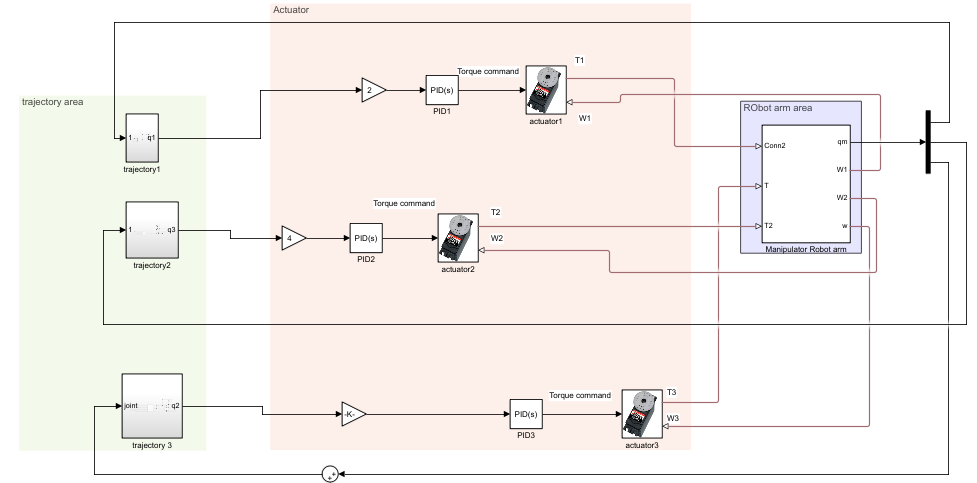

## Project at a glance

| Aspect | Documented implementation |
|---|---|
| Application | Robotic-manipulator motion modelling and trajectory tracking |
| Environment | MATLAB / Simulink / Simscape |
| Mechanical model | Interconnected rigid bodies, transformations, rotational joints and an end-effector reference frame |
| Actuation | Three DC motor actuation paths discussed in the report |
| Reference motion | Polynomial joint-position, velocity and acceleration profiles |
| Baseline controller | Manually tuned joint PID loops |
| Model-informed controller | Computed-torque-style law incorporating a manipulator inertia model and other dynamics terms |
| Results | Joint tracking plots, motor-current signals and position/velocity plots |
| Deliverables available here | Report-derived explanation and extracted screenshots; **original `.slx` / `.m` project files were not supplied** |

## 1. Robot geometry and joint assembly

The report begins by constructing a simplified base shape and connecting cylindrical/rigid elements using Simscape Multibody transformations and rotational joints. It discusses aligning joint axes, assigning successive body frames and observing the end-effector position relative to the robot base.

### Base geometry

The report includes the following MATLAB snippet to generate a planar cross-section for an extruded base component:

```matlab
X1 = 20:-1:-20;
y1 = sqrt(30^2 - X1.^2);
X2 = -20:1:20;
y2 = -sqrt(30^2 - X2.^2);
X = [X1 X2];
Y = [y1 y2];
A = [X; Y]';
plot(X,Y);
axis equal;
```

**Figure 1.** Example base-solid geometry shown in the original report.

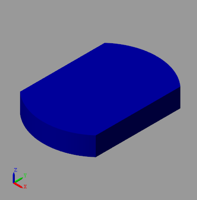

**Figure 2.** Screenshots of successive robot-link assembly and rigid-transform arrangements.

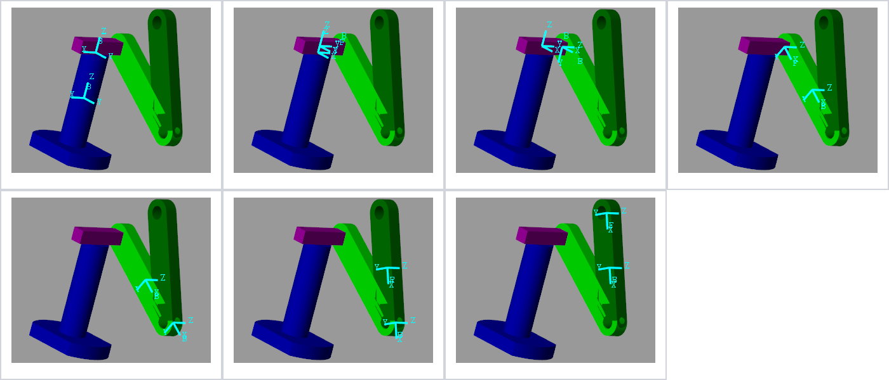

**Figure 3.** End-effector reference-frame configuration shown in the source report.

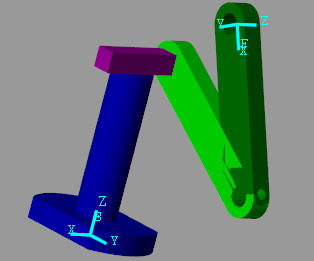

### Frames and kinematics

The report describes transformations between adjacent frames and their composition to obtain the end-effector pose. The common homogeneous transformation notation is:

$$
{}^{0}T_{3} = {}^{0}T_{1}\,{}^{1}T_{2}\,{}^{2}T_{3},
\qquad
T = \begin{bmatrix}R & p\\0\;0\;0 & 1\end{bmatrix}.
$$

Here, $R$ is the rotation matrix and $p$ the translation vector. The report discusses the Jacobian and singular configurations at a conceptual level; it does not supply a fully verified numerical kinematic model for all six joints.

## 2. Reference-trajectory generation

A time-dependent reference is constructed for the manipulator joints. The report discusses the possibility of fifth-order trajectories, but the **explicit equations implemented in the text are cubic**, with specified endpoint positions and zero endpoint velocities:

$$
q(t)=q_0+3\frac{q_f-q_0}{t_f^2}t^2-2\frac{q_f-q_0}{t_f^3}t^3,
$$

$$
\dot q(t)=6\frac{q_f-q_0}{t_f^2}t-6\frac{q_f-q_0}{t_f^3}t^2,
$$

$$
\ddot q(t)=6\frac{q_f-q_0}{t_f^2}-12\frac{q_f-q_0}{t_f^3}t.
$$

The expressions assume motion starts at $t=0$ and ends at $t=t_f$. Joint angles are expressed in radians. **Unlike a quintic trajectory, this cubic does not generally impose zero acceleration at both endpoints**; that distinction matters when reproducing the simulation.

**Figure 4.** Reference trajectory/tracking response from the report.

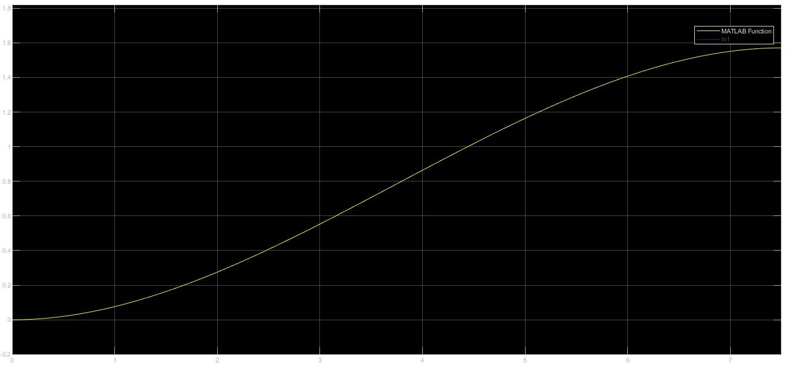

## 3. DC motor and actuation model

The report models the interaction of armature voltage, current, motor speed and torque, then assembles electrical and mechanical components, including drive/shaft connections, in Simscape. Its base relationships are:

$$
\tau_m = k_t i_a-c\omega_m,
\qquad
V_a=L_a\frac{di_a}{dt}+R_a i_a+k_e\omega_m,
$$

where $V_a$ is armature voltage, $i_a$ current, $L_a$ inductance, $R_a$ resistance, $k_t$ torque constant, $k_e$ back-EMF constant, $c$ the viscous-friction coefficient and $\omega_m$ angular velocity. Subscripts and symbols have been made consistent for readability; see the original report for its notation.

**Figure 5.** DC-motor and related mechanical elements represented in Simscape.

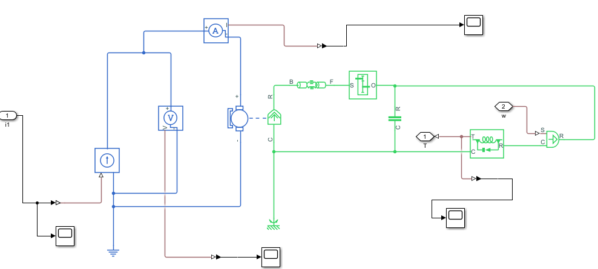

## 4. Initial PID joint controller

Three separate joint position-control loops are evaluated first. In the report, controller tuning is performed **manually**, and the results are plotted for each joint. The initial results demonstrate relatively good tracking for one joint and noticeable oscillatory or less satisfactory behaviour for others.

**Figure 6.** PID response of joint 1.

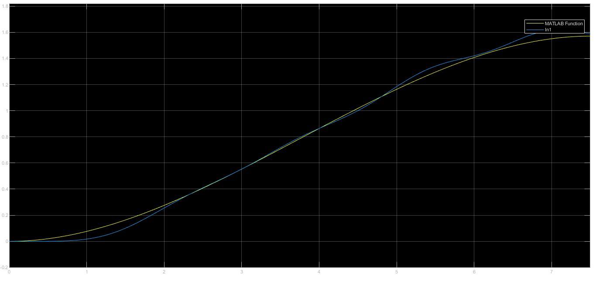

**Figure 7.** PID response of joint 2.

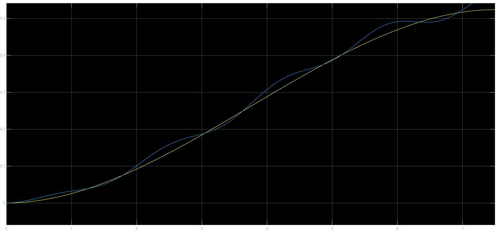

**Figure 8.** PID response of joint 3.

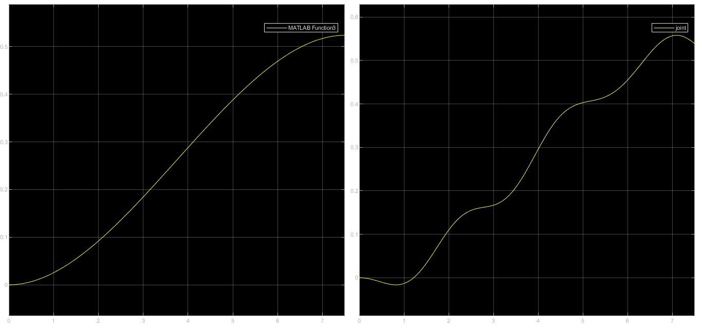

**Figure 9.** Overall Simulink controller and actuator layout (also shown at the top of this README).


## 5. Dynamics-informed / computed-torque-style control

To address tracking limitations, the report describes incorporating manipulator dynamics into the joint torque command. Expressed in conventional, clarified notation, the discussed control structure is:

$$
\tau = M(q)\left[\ddot q_d+K_d(\dot q_d-\dot q)+K_p(q_d-q)\right]+n(q,\dot q),
$$

where:

- $q$, $\dot q$: measured/estimated joint position and velocity;
- $q_d$, $\dot q_d$, $\ddot q_d$: desired reference trajectory and its derivatives;
- $M(q)$: manipulator inertia matrix;
- $n(q,\dot q)$: aggregate velocity-dependent and gravitational terms;
- $K_p$, $K_d$: feedback gains.

This is a **standardised rendering of the control-law concept** in the source, not an independently validated derivation of its particular robot model. The document reports importing the robot to access dynamics-related information with MATLAB's `importrobot` / `rigidBodyTree` tooling. Its actual software files, complete parameter matrices and gain values were not included in the PDF.

**Figure 10.** Controller block-diagram screenshot from the report.

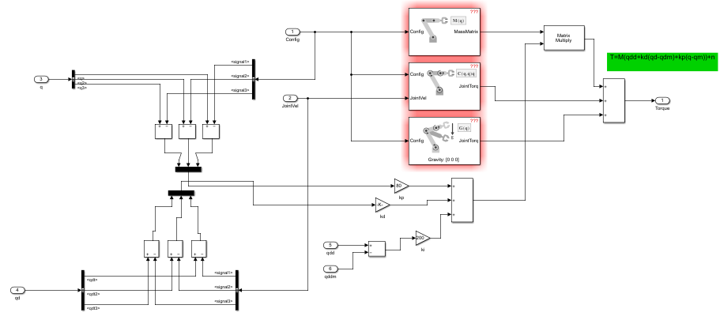

**Figure 11.** Subsequent controller implementation diagram.

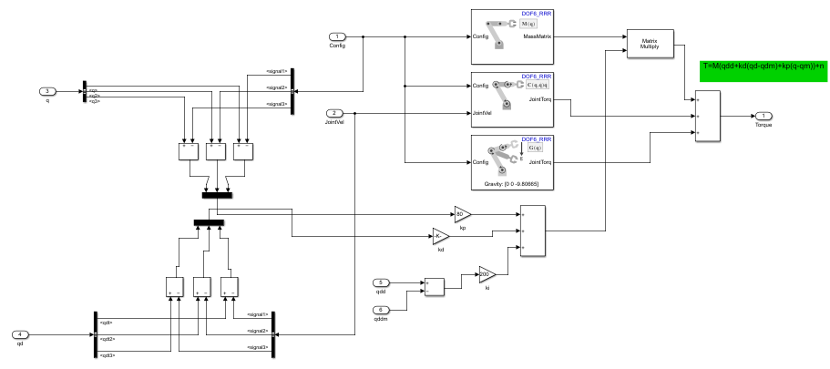

## 6. Simulation results

The figures below reproduce the visual evidence included in the original course report. The report describes more stable reference tracking after adding dynamics-informed terms, with comparisons of joint signals, motor current and position/velocity behaviour. **Plots are included as published; no numeric error reduction or physical hardware performance is inferred from them.**

### Joint-reference tracking after the controller update

| Joint 1 | Joint 2 | Joint 3 |
|---|---|---|
| 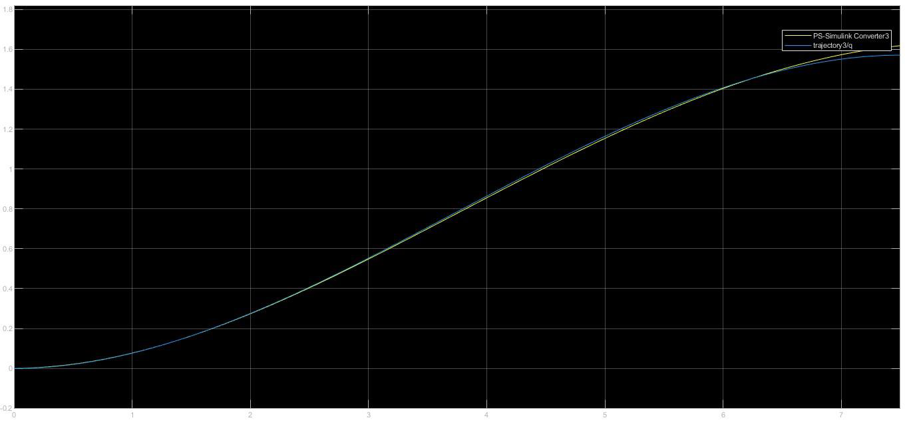 | 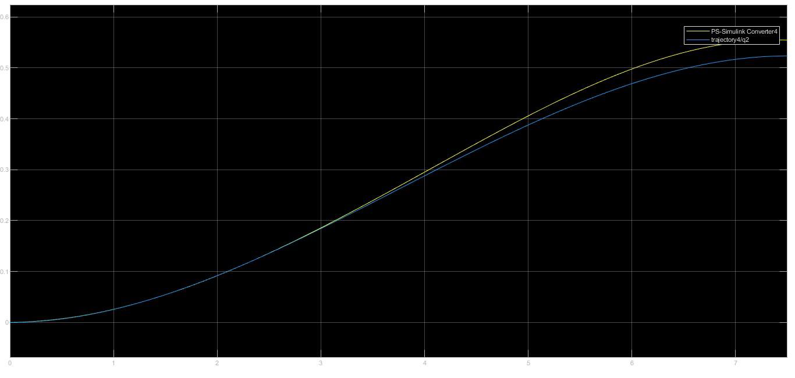 | 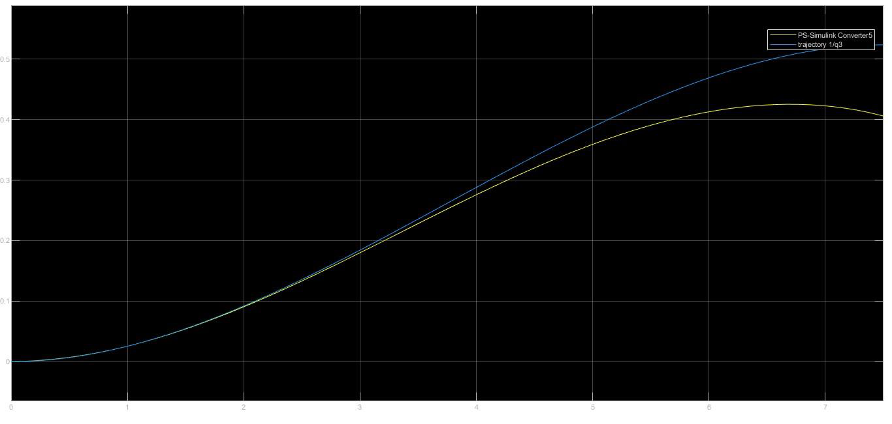 |

### Electrical and additional joint signals

**Figure 15.** Simulated motor-current response.

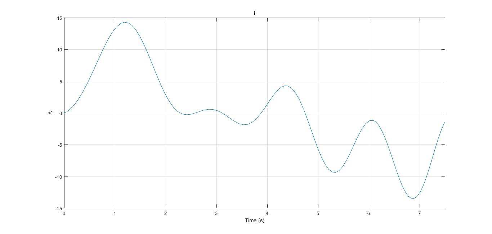

**Figure 16.** Motor-current plot used in the control/sensor comparison.

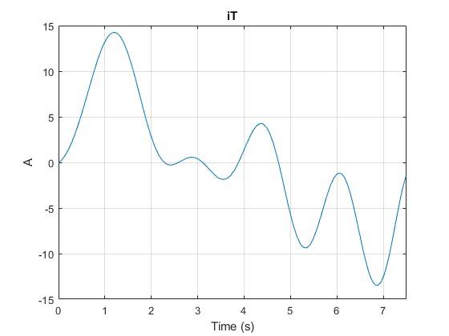

**Figure 17.** Six joint-related current/signal traces presented in the report.

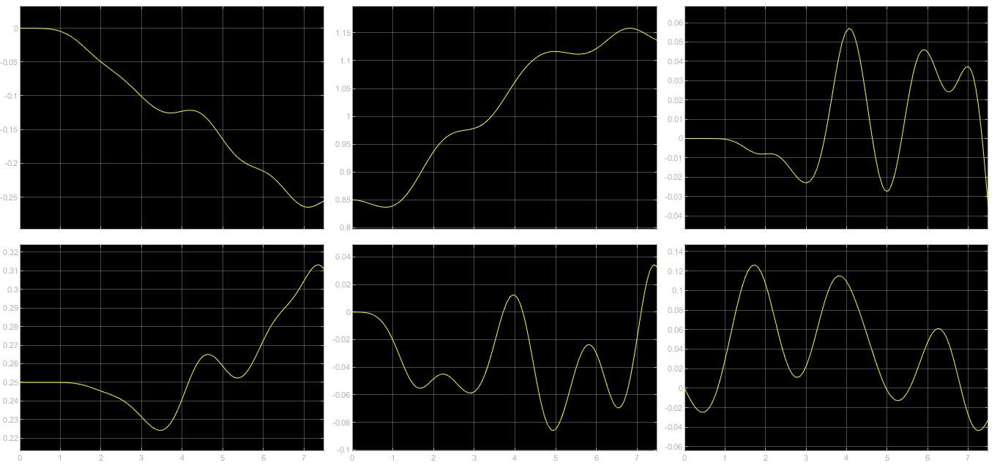

**Figure 18.** Final position/velocity comparison for the simulated robot.

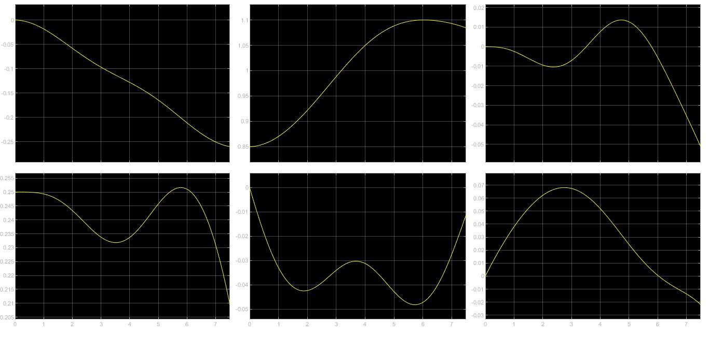

### Interpretation

- The source reports oscillations and insufficiently smooth tracking in parts of the manually tuned PID setup.
- The later dynamics-informed control arrangement is described as giving improved tracking in the displayed simulation.
- The document does **not** provide benchmark data, numerical error tables, source-model parameter values or hardware validation, so its results should be interpreted as a course-project simulation study.

## Reproducing the project

This repository is a **documentation-first conversion of the original PDF report**. It currently contains the original report and report-derived visual assets, but does not contain the executable Simulink/Simscape model, user-defined MATLAB functions or numerical parameter tables. Accordingly, the simulation **cannot yet be reproduced from this repository alone**.

If the original project files are subsequently added, they can be organised as `models/` (Simulink/Simscape models), `scripts/` (MATLAB code), and `results/` (generated output), with the MATLAB release and required toolbox versions stated here.

## Document provenance and limitations

- Text has been adapted and translated from the **user-provided 20-page Persian report**, with original screenshots preserved as image assets.
- Equations are typeset in GitHub-compatible math notation; a few expressions have been clarified or normalised for consistent symbols. The source PDF remains authoritative for the historical report.
- The original project title mentions 6-DOF operation and object identification/placement, while the shown control subsystem is organised around three rotational joints. No object-recognition system is documented here.
- The figures are **simulation screenshots**, not photographs of an experimental prototype.

## Repository layout

```text
.
├── README.md
├── GITHUB_DESCRIPTION.txt
├── assets/
│   └── figures/
│       ├── 01_base_geometry.png
│       ├── 02_robot_assembly_sequence.png
│       └── ...  (18 figure files in total)
└── docs/
    └── Original_Report_Persian.pdf
```

**Author:** Erfan Yavari · **Institution:** K. N. Toosi University of Technology · **Course:** Mechatronics I
